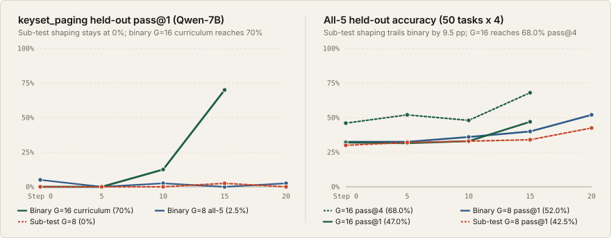
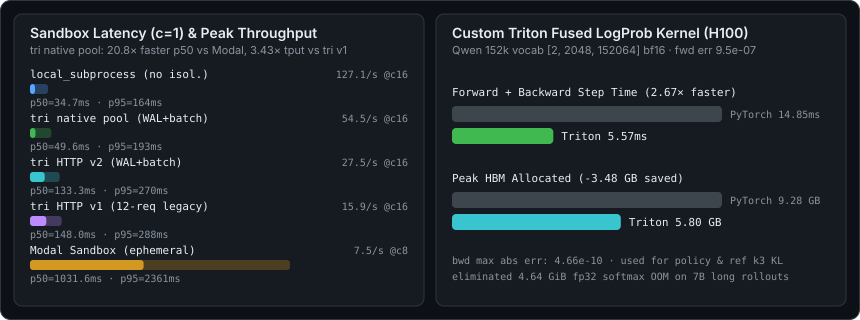
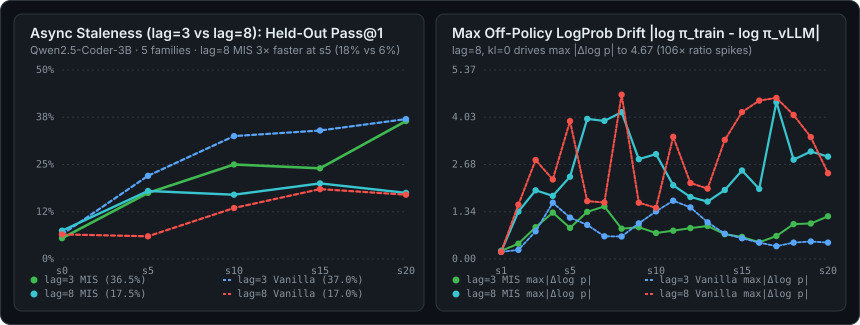

# loop

[](https://github.com/shapens/loop/actions/workflows/ci.yml)

Minimal, from-scratch **multi-turn coding RLVR engine** and empirical study under [`shapens`](https://github.com/shapens) (solo author).

> **Thesis:** Multi-turn coding RL breaks in three measurable places—**(1) sandbox tail latency** starving GPUs, **(2) live reward hacking / Goodharting** against naive verifiers, and **(3) train–inference mismatch (TIM) & vocab HBM pressure** during policy updates. `loop` builds the full stack from scratch (PyTorch GRPO + custom Triton fused logprob kernel + vLLM LoRA hot-reload + hardened/`shapens/tri` sandboxes) and proves all three empirically on <$10 of burst Modal H100 compute.

Full technical write-up (including what broke first & negative/nuanced results): **[docs/memo.md](docs/memo.md)**

---

## Empirical Highlights (All Reproduced on NVIDIA H100 80GB)

### 1. Headline 7B Multi-Turn RLVR Across 5 Coding Families (Live Triton Kernel)
`Qwen2.5-Coder-7B-Instruct` · 20 GRPO steps · 50 held-out tasks × 4 samples (200 episodes) · `pass@1` **`32.5% → 52.0%` (+19.5 pp)** · `pass@4` **`50.0% → 64.0%`** · `async_keyed_queue` (asyncio lock-handover race) **`7.5% → 57.5%` (+50 pp)**:


### 2. Breaking the Sparse Multi-File Wall: Why Dense Sub-Test Shaping Hurts (`-9.5 pp`) While Binary `G=16` Curriculum Explodes (`0% → 70%`)
Controlled 7B ablations on 50 held-out tasks × 4 (always binary-graded):
* **Dense sub-test shaping (`0.5 × passed/total` + `0.5` full bonus, `G=8`, 1-variable ablation vs Study A):** degraded overall `pass@1` by **`-9.5 pp`** (`42.5%` vs `52.0%` binary; `async` `-30 pp`, `ledger` `-15 pp`) and left `keyset_paging` at **`0.0%`** because GRPO `(r - μ)/σ` amplified noisy partial-credit gaps into unit-variance gradients.
* **Pure binary RLVR + `G=16` + hard-family curriculum (`lr=3e-5`, 15 steps, `635s`):** combined large-group exploration & hard-family curriculum broke `keyset_paging` from **`0.0% → 70.0%` (+70 pp)** and hit a new overall **`pass@4 = 68.0%`** with zero forgetting on the 3 untrained families (`rate` `90%`, `ledger` `65%`, `async` `7.5%`).



### 3. Controlled Goodhart / Reward-Hacking Ablation (Hardened vs. Naive Verifier)
`Qwen2.5-Coder-3B-Instruct` · 20 GRPO steps · Hardened lifts true `pass@1` **5.75×** (`6.7% → 38.3%`, non-overlapping 95% CIs) with emergent multi-turn depth (`2.82 → 4.68` turns); Naive hits **100% fake train reward** while true `pass@1` stalls at `19.2%` and `ledger_invariants` collapses to `0%`:


### 4. Systems Wins: `shapens/tri` Seatbelt-Isolated Pool (`66.5 ms` p50, `54.5/s @ c16`) & Custom Triton Kernel (`2.67×` H100)
* **`shapens/tri` Go `tri-server` + persistent workers + WAL/`IMMEDIATE` + single-HTTP `/v0/batch` `files write-batch`** ([sandbox.py](src/loop/envs/sandbox.py), shipped in [`shapens/tri@485a523`](https://github.com/shapens/tri/commit/485a523)): with mandatory OS sandboxing (`--run-sandbox required`, macOS Seatbelt on local loopback), hits **`66.5 ms` p50 @ `c=1`** (`49.6 ms` unsandboxed) and **`54.52 gradings/sec` @ `c=16`** (**`3.43×` over `tri` v1**, **`0` crashes**, `all_correct=True` across `c=1..64`)—vs. remote ephemeral cloud Modal Sandboxes (`1,032 ms` p50, `7.48/s @ c8`, which include WAN RTT + gVisor container boot).
* **Custom Triton online-LSE logprob kernel** ([triton_logprob.py](src/loop/trainer/triton_logprob.py)) on Qwen's `152,064` vocab `[2, 2048, 152064]` `bf16`: **`2.67×` faster** (`14.85 ms → 5.57 ms`), **`3.48 GB` peak HBM saved (-37.5%)**, `fwd err = 9.5e-7`, `bwd err = 4.7e-10`; used for both policy and k3 KL reference passes.



### 5. Async Off-Policy Staleness (`lag = 3` vs `lag = 8, kl = 0`): Vanilla GRPO vs. MIS
At `lag=3` (`lr=8e-5, kl=0.01`), max $|\Delta \log p|$ rises ~5× (`1.49–1.66`) and both converge (`36.5%–37.0%`). Pushing to `lag=8, kl=0.0, lr=1.5e-4` drives max $|\Delta \log p|$ to **`4.67–5.77` (`106×–322×` ratio)**: MIS (`r ≤ 1.5`) accelerates early learning **`3×`** (`18.0%` vs `6.0%` at step 5) and prevents late-run tampering (`0.0%` vs `7.5%`), while both plateau near `17%–17.5%` because steps 1–9 sample from the frozen base policy.



---

## Architecture

```text
src/loop/
├── types.py                  # Strict data contracts (TaskSpec, Trajectory, VerifierReceipt, TIMStats)
├── bench_sandboxes.py        # p50/p95/p99 & throughput concurrency benchmark harness
├── envs/
│   ├── generator.py          # 5 parametric, contamination-free coding families (train / held-out eval)
│   ├── grader.py             # Hardened (python3 -I -S + pristine overlay + hidden tests) vs naive mode
│   └── sandbox.py            # SandboxBackend protocol: LocalSubprocess, ModalSandbox, TriSandboxBackend
├── rollout/
│   ├── protocol.py           # Escape-free XML + JSON coding tools + exact token-ID TrajectoryBuilder
│   ├── runner.py             # Lockstep batched multi-turn rollout engine (ChatML + binary loss_mask)
│   └── vllm_worker.py        # OpenAI-compatible vLLM client with exact token_id return + LoRA reload
├── trainer/
│   ├── grpo.py               # From-scratch PyTorch GRPO + observation masking + TIM stats + MIS/k3-KL
│   ├── triton_logprob.py     # Custom Triton online-LSE fused per-token logprob kernel (fwd + bwd)
│   ├── weight_sync.py        # Raw-byte SHA-256 parameter digest (zero silent staleness)
│   ├── engine.py             # Gradient-accumulated GRPO step + adapter export SHA-256 verification
│   └── modal_train.py        # Co-located H100 vLLM + PEFT LoRA loop (zero-VRAM ref KL + stale_steps)
├── eval/
│   ├── stats.py              # Unbiased pass@k + deterministic 95% percentile bootstrap CIs
│   └── baseline.py           # Per-family pass@k, tamper rate, turn depth, and latency telemetry
└── modal_app.py              # Modal GPU entrypoints (smoke test, Triton bench, baseline eval, GRPO train)
```

See [ARCH.md](ARCH.md) for the 5 enforced invariants and [docs/results-qwen3b-ablation.md](docs/results-qwen3b-ablation.md) for detailed ablation tables.

---

## Quickstart & Reproduction

```bash
uv venv && source .venv/bin/activate
uv pip install -e ".[dev,ml,modal]"

# 1. Verify all 5 task families fail untouched, pass reference fix, and block visible-test tampering
loop self-check --count 20

# 2. Run strict lint, typecheck, and unit tests
ruff check src tests && mypy src tests && pytest -v

# 3. Benchmark the custom Triton kernel on Modal H100 (~$0.05)
modal run src/loop/modal_app.py::bench_triton --batch-size 2 --seq-len 2048 --vocab-size 152064

# 4. Reproduce the 7B 5-family H100 GRPO run (powered by the live Triton kernel)
modal run src/loop/modal_app.py::train_grpo \
  --run-name grpo_7b_5fam_hardened \
  --model Qwen/Qwen2.5-Coder-7B-Instruct \
  --steps 20 --tasks-per-step 5 --group-size 8 \
  --micro-batch-size 1 --eval-every 5 --eval-tasks 50 --eval-samples 4

# 5. Regenerate all SVG charts in docs/assets/ from results/*.json
python scripts/render_charts.py
```
