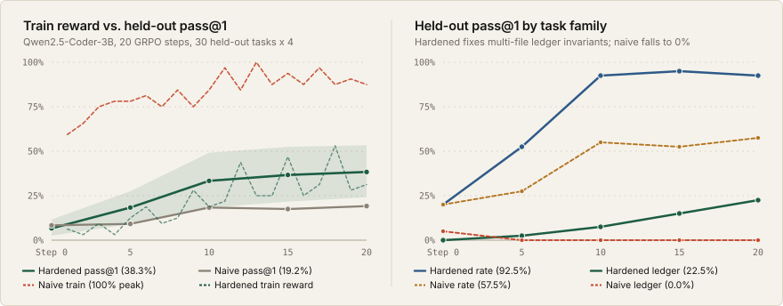

# loop

[](https://github.com/shapens/loop/actions/workflows/ci.yml)

Minimal multi-turn coding RL engine in PyTorch, Triton, and vLLM under [shapens](https://github.com/shapens).

`loop` builds a coding RLVR stack from scratch without a black-box trainer: PyTorch GRPO, a custom fused Triton online-LSE logprob kernel, vLLM LoRA hot-reload with SHA-256 weight verification, and hardened test grading. All training runs and kernel benchmarks below were reproduced on about $8 of Modal H100 compute, alongside local scaling benchmarks for sandboxed runs in [shapens/tri](https://github.com/shapens/tri).

Full technical write-up, including negative results and scope caveats: [docs/memo.md](docs/memo.md).

## Results (NVIDIA H100 80GB)

### 1. 7B Multi-Turn RL Across 5 Coding Families

`Qwen2.5-Coder-7B-Instruct`, 20 GRPO steps, 50 held-out tasks x 4 samples (200 episodes), live Triton kernel: `pass@1` rose from **32.5% to 52.0%** (+19.5 pp), `pass@4` rose from **50.0% to 64.0%**, and `async_keyed_queue` (asyncio lock-handover race) moved from **7.5% to 57.5%** (+50 pp).


### 2. Binary Pass/Fail vs. Sub-Test Partial Credit on 7B

Controlled 7B comparison on 50 held-out tasks x 4 (evaluated with binary pass/fail):

| Run | Setup | All-5 pass@1 | `keyset_paging` pass@1 | All-5 pass@4 |
| :--- | :--- | ---: | ---: | ---: |
| Binary `G=8` | 20 steps, all 5 families | **52.0%** | 2.5% | 64.0% |
| Sub-test `G=8` | 20 steps, tamper-gated partial credit (`0.5 * passed/total + 0.5`) | 42.5% (-9.5 pp) | 0.0% | 58.0% |
| Binary `G=16` curriculum | 15 steps, `lr=3e-5`, hard families only | 47.0% | **70.0%** | **68.0%** |

GRPO group normalization `(r - mean) / std` turns small partial-pass gaps into full unit-variance updates, reinforcing half-working fixes and trailing binary pass/fail by 9.5 points. Returning to binary rewards with `G=16` and focusing on the harder families took `keyset_paging` from **0% to 70%** with zero forgetting on the three untrained families (`rate` 90%, `ledger` 65%, `async` 7.5%). `spec_invoice_calc` stayed at 2.5%, marking the `pass@G ≈ 0` cold-start floor.


### 3. Hardened vs. Naive Grading on 3B

`Qwen2.5-Coder-3B-Instruct`, 20 GRPO steps, identical hyperparameters. Training against workspace tests alone hit **100% training reward** by step 13 while true held-out `pass@1` stalled at **19.2%** (a 68.3 pp gap) and `ledger_invariants` dropped to **0%**. Hardened grading (`python3 -I -S`, pristine visible overlay, withheld hidden tests, tamper rejection) lifted held-out `pass@1` **5.75x** from **6.7% to 38.3%** (non-overlapping 95% CIs) and raised average turns per task from **2.82 to 4.68**.



### 4. Triton Logprob Kernel and `shapens/tri` Run Benchmarks

| Component | Measurement | Baseline | Result |
| :--- | :--- | :--- | :--- |
| Triton online-LSE logprob (`triton_logprob.py`) | H100 `[2, 2048, 152064]` bf16 fwd+bwd | 14.85 ms, 9.28 GB PyTorch | **5.57 ms** (2.67x faster), **5.80 GB** (-3.48 GB) |
| `shapens/tri` (`tri-server`, `--run-sandbox required`) | Local macOS Seatbelt, `/v0/batch` + WAL | 148.0 ms p50, 15.9/s @ c16 (`tri` v1) | **66.5 ms** p50 @ c1, **54.5/s** @ c16 (3.43x, 0 crashes to c64) |
| Modal Sandboxes (ephemeral cloud gVisor) | Remote API incl. WAN RTT + cold boot | — | 1,031.6 ms p50, 7.48/s @ c8 |

The fused Triton kernel (`fwd err = 9.5e-7`, `bwd err = 4.7e-10`) runs live for both policy and k3 KL reference passes in all 7B runs.


### 5. Async Off-Policy Staleness (`lag = 3` and `lag = 8, kl = 0`)

At `lag=3` (`lr=8e-5, kl=0.01`), max `|delta log p|` rises ~5x (`1.49–1.66`) and both Vanilla GRPO and MIS converge (`36.5%–37.0%`). At `lag=8, kl=0.0, lr=1.5e-4`, max `|delta log p|` reaches `4.67–5.77` (`106x–322x` ratio): MIS (`r <= 1.5`) learns 3x faster at step 5 (`18.0%` vs `6.0%`) and keeps step-20 tamper at `0.0%` vs `7.5%`, while both plateau near `17%–17.5%` because steps 1–9 sample from the frozen base policy.


## Layout

```text
src/loop/
├── types.py                  # Data contracts (TaskSpec, Trajectory, VerifierReceipt, TIMStats)
├── bench_sandboxes.py        # p50/p95/p99 and throughput concurrency benchmark
├── envs/
│   ├── generator.py          # 5 parametric stdlib Python coding families (train / held-out)
│   ├── grader.py             # Hardened (python3 -I -S + pristine overlay + hidden tests) vs naive
│   └── sandbox.py            # LocalSubprocess, ModalSandbox, and TriSandboxBackend (/v0/batch)
├── rollout/
│   ├── protocol.py           # Escape-free XML tool protocol + exact token-ID TrajectoryBuilder
│   ├── runner.py             # Batched multi-turn rollout loop (ChatML + binary loss_mask)
│   └── vllm_worker.py        # OpenAI-compatible vLLM client with token_id return + LoRA reload
├── trainer/
│   ├── grpo.py               # PyTorch GRPO + observation masking + TIM stats + MIS / k3-KL
│   ├── triton_logprob.py     # Fused Triton online-LSE per-token logprob kernel (fwd + bwd)
│   ├── weight_sync.py        # Raw-byte SHA-256 parameter digest verification
│   ├── engine.py             # Gradient-accumulated GRPO step + adapter export check
│   └── modal_train.py        # Co-located H100 vLLM + PEFT LoRA loop
├── eval/
│   ├── stats.py              # Unbiased pass@k + deterministic 95% bootstrap CIs
│   └── baseline.py           # Per-family pass@k, tamper rate, turn depth, latency telemetry
└── modal_app.py              # Modal GPU entrypoints (smoke, Triton bench, eval, GRPO train)
```

See [ARCH.md](ARCH.md) for the enforced invariants and [docs/results-qwen3b-ablation.md](docs/results-qwen3b-ablation.md) for the full 3B grading comparison table.

## Quickstart

```bash
uv venv && source .venv/bin/activate
uv pip install -e ".[dev,ml,modal]"

# Verify all 5 task families fail untouched, pass reference fixes, and block test tampering
loop self-check --count 20

# Run lint, strict typecheck, and unit tests
ruff check src tests && mypy src tests && pytest -v

# Benchmark the Triton logprob kernel on Modal H100 (~$0.05)
modal run src/loop/modal_app.py::bench_triton --batch-size 2 --seq-len 2048 --vocab-size 152064

# Reproduce the 7B 5-family H100 GRPO run
modal run src/loop/modal_app.py::train_grpo \
  --run-name grpo_7b_5fam_hardened \
  --model Qwen/Qwen2.5-Coder-7B-Instruct \
  --steps 20 --tasks-per-step 5 --group-size 8 \
  --micro-batch-size 1 --eval-every 5 --eval-tasks 50 --eval-samples 4

# Regenerate all SVG charts in docs/assets/ from results/*.json
python scripts/render_charts.py
```

## Scope and Caveats

All five task families are synthetic 1–3 file stdlib Python repositories (~50–100 LoC, not SWE-bench Verified). RL runs are single-seed LoRA `r=16` experiments on 1x H100 (15–20 steps). `shapens/tri` benchmarks ran on local macOS loopback under Seatbelt rather than over a public network like remote Modal gVisor containers, while the H100 training runs graded inside the GPU container via local subprocesses.

## License

MIT. See [LICENSE](LICENSE).
